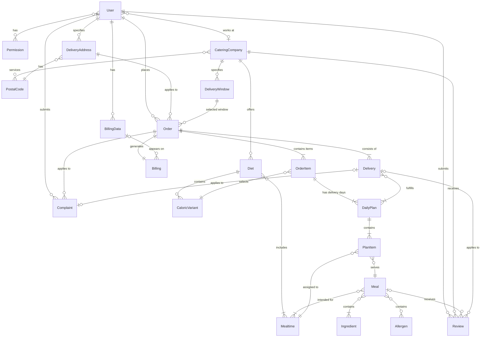

# Diagram ERD - Agregator diet pudełkowych

## Diagram Mermaid

## Uwagi do modelu

* `OrderItem` reprezentuje jedną pozycję zamówienia, czyli dietę jednego domownika w ramach zamówienia. Atrybuty: `recipient` (etykieta, np. „Tata"), opcjonalnie `quantity` (gdy kilka osób bierze ten sam wariant i te same dni).

* `DailyPlan` to konkretny plan dnia z atrybutem `date` (dni wybrane przez danego domownika). Fizyczne doręczenie (`Delivery`) może realizować wiele planów z różnych dni i różnych domowników.

* „Dokładnie jeden posiłek na porę dnia" wymusza unikalność pary (DailyPlan, Mealtime) w `PlanItem` — niewyrażalne w diagramie ERD.

